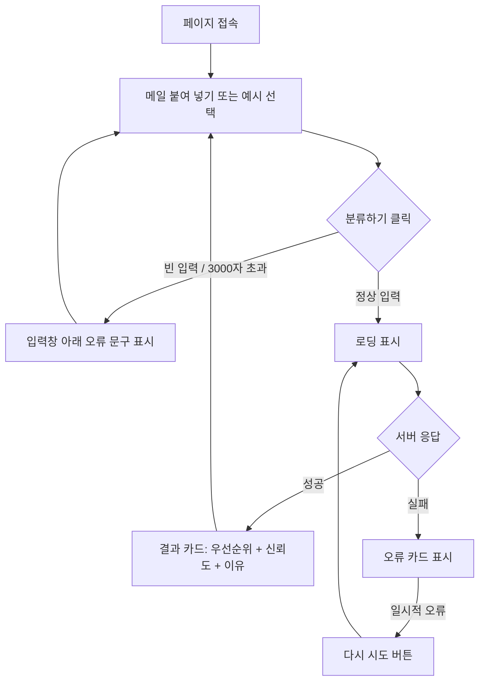

# PRD.md — 메일 우선순위 분류 서비스 제품 요구사항

> PRD(Product Requirements Document)는 "무엇을, 왜, 어디까지 만드는지"를 정리한 문서입니다.
> "어떻게 만드는지"는 `docs/` 폴더의 세부 문서에 있습니다.

---

## 1. 개요

| 항목 | 내용 |
|---|---|
| 서비스 이름 | 메일 우선순위 분류기 (화면 표시명: **메일 우선순위 분류기**) |
| 한 줄 소개 | 메일 제목과 본문을 붙여 넣으면 AI가 처리 우선순위를 **즉시 / 오늘 / 나중**으로 분류하고, 얼마나 확신하는지와 그 이유를 알려주는 웹 서비스 |
| 대상 기기 | PC·태블릿·스마트폰 웹 브라우저 |
| 언어 | 화면 문구는 한국어. 메일은 어떤 언어든 가능하며 판단 이유는 항상 한국어로 표시 |

### 1.1 만드는 이유
- 받은 메일이 많을 때 "지금 당장 봐야 하는 메일"을 빨리 골라내도록 돕습니다.
- 결과만 보여주지 않고 **이유**(마감 시점, 요청 내용, 영향 범위)를 함께 보여주어, 사용자가 AI 판단을 검토할 수 있게 합니다.

### 1.2 목표
1. 메일 붙여 넣기 → 결과 확인까지 **한 화면에서** 끝난다.
2. 결과는 **우선순위(즉시/오늘/나중) + 신뢰도(%) + 판단 이유** 세 가지를 항상 함께 보여준다.
3. 문제가 생기면 사용자가 **무엇을 하면 되는지** 알 수 있는 오류 메시지를 보여준다.

### 1.3 핵심 흐름 (1줄)
메일 본문 입력 → 우선순위(즉시/오늘/나중) 분류 → 등급·신뢰도·판단 이유 표시

---

## 2. 용어 설명 (비전공자용)

| 용어 | 쉬운 설명 |
|---|---|
| 우선순위 분류 | 메일을 얼마나 빨리 처리해야 하는지 정해진 등급(즉시/오늘/나중) 중 하나로 나누는 것 |
| 신뢰도 | AI가 자기 판단을 얼마나 확신하는지 0~100%로 나타낸 값. **정답 확률이 아니라 AI의 추정치**입니다 |
| 기준 날짜 | "내일까지", "이번 주 금요일" 같은 표현을 해석하기 위해 서버가 AI에게 알려 주는 오늘 날짜(한국 시간) |
| 프론트엔드 | 사용자가 브라우저에서 보는 화면 (HTML·CSS·JS) |
| 백엔드 | 화면 뒤에서 일하는 서버 프로그램 (여기서는 Node.js) |
| API | 프로그램끼리 데이터를 주고받는 약속된 창구. 화면은 `/api/classify`라는 창구로 서버에 분류를 요청합니다 |
| OpenAI API | ChatGPT를 만든 OpenAI가 제공하는 AI 기능을 프로그램에서 쓸 수 있게 해 주는 유료 서비스 |
| API 키 | OpenAI API를 쓸 수 있는 비밀 열쇠. **절대 화면 코드나 공개 저장소에 넣으면 안 됩니다** |
| 환경변수 | API 키처럼 비밀스러운 값을 코드 밖에 따로 보관하는 설정값 |
| Vercel | 만든 웹사이트를 인터넷에 올려 주는(배포) 서비스 |
| Vercel Function | Vercel에서 요청이 올 때만 잠깐 실행되는 서버 코드 |
| 웹폰트 | 사용자 컴퓨터에 없어도 인터넷에서 받아 쓰는 글꼴 (여기서는 Pretendard) |

---

## 3. 사용자와 사용 시나리오

### 3.1 대상 사용자
- 하루에 수십 통의 업무 메일을 받는 직장인
- 고객 문의 메일을 1차로 걸러야 하는 운영·CS 담당자

### 3.2 대표 시나리오
1. 사용자가 사이트에 접속한다.
2. 메일 앱에서 메일 제목과 본문을 복사해 입력창에 붙여 넣는다.
3. **분류하기** 버튼을 누른다.
4. 1~10초 안에 결과 카드에 **즉시 · 신뢰도 95% · 이유: '지금 바로'라는 요청과 결제 장애로 즉시 대응이 필요해요.** 가 표시된다.

---

## 4. 분류 기준

이 기준은 AI에 전달하는 프롬프트(`docs/04` §4.3)와 같습니다.

| 등급 | 코드 | 의미 | 대표 예 |
|---|---|---|---|
| **즉시** | `urgent` | 몇 시간 안에 대응하지 않으면 손실·장애·큰 불편이 생김 | 서비스 장애·보안 사고, 몇 시간 안의 마감, 상사·고객의 "지금 바로" 요청, 결제·계약 실패 |
| **오늘** | `today` | 오늘 안에 답장하거나 처리하면 됨 | 오늘·내일 오전 마감, 답장 요청, 회의 일정 확인, 자료 검토 요청 |
| **나중** | `later` | 급하지 않음, 참고용 | 뉴스레터, 광고, 사내 공지, 단순 공유(참조), 마감이 2일 이상 남은 요청 |

**판단 규칙**
- "긴급", "ASAP" 같은 단어가 아니라 **실제 마감 시점과 영향**으로 판단합니다. 광고 메일의 "[긴급] 특가"는 `later`입니다.
- 마감 표현("내일까지", "금요일까지")은 서버가 알려 주는 **기준 날짜(한국 시간)** 로 계산합니다.
- 애매하면 한 단계 높은 등급을 고르되, 신뢰도를 낮게(40~70) 표시합니다.
- 피싱·스팸 여부는 판별하지 않습니다(범위 밖).

---

## 5. 기능 요구사항

각 요구사항에는 ID가 있습니다. 코드 리뷰와 테스트에서 이 ID로 부릅니다.

| ID | 기능 | 우선순위 | 수용 기준(이렇게 되면 완료) |
|---|---|---|---|
| FR-01 | 메일 입력 | 필수 | 여러 줄 입력창이 있고, 1~3,000자(앞뒤 공백 제외)까지 입력·분류할 수 있다 |
| FR-02 | 글자 수 표시 | 필수 | 입력창 아래에 `현재 글자 수 / 3000`이 실시간 표시되고, 3,000자를 넘으면 빨간색으로 바뀐다 |
| FR-03 | 분류 요청 | 필수 | **분류하기** 버튼 클릭 또는 `Ctrl+Enter`(Mac은 `⌘+Enter`)로 서버에 분류를 요청한다 |
| FR-04 | 결과 표시 | 필수 | 우선순위를 **즉시 / 오늘 / 나중** 중 하나로, 등급별 색상(빨강/주황/회색)과 함께 표시한다 |
| FR-05 | 신뢰도 백분율 | 필수 | 0~100 사이 정수와 `%` 기호, 그리고 같은 비율의 막대그래프로 표시한다 |
| FR-06 | 판단 이유 | 필수 | 판단 근거를 한국어 1~2문장으로 표시한다. 근거가 된 표현(마감·요청 문구)을 작은따옴표로 인용한다 |
| FR-07 | 입력 검증 오류 | 필수 | 빈 입력으로 분류하면 서버 요청 없이 입력창 아래에 오류 문구를 표시한다. 3,000자 초과도 같다 |
| FR-08 | 서버·AI 오류 메시지 | 필수 | 서버·네트워크·AI 오류 시 결과 영역에 오류 카드를 표시한다. 문구는 `docs/05` 기준표를 따른다 |
| FR-09 | 다시 시도 | 필수 | 일시적 오류(시간 초과, 요청 과다 등)일 때만 오류 카드에 **다시 시도** 버튼을 보여준다 |
| FR-10 | 로딩 표시 | 필수 | 분류 중에는 버튼 문구가 `분류 중…`으로 바뀌고 비활성화되며, 결과 영역에 로딩 표시가 나온다 |
| FR-11 | 중복 요청 방지 | 필수 | 분류 중에는 추가 요청이 전송되지 않는다 |
| FR-12 | 예시 메일 | 필수 | 예시 버튼 3개(서버 장애·자료 검토·사내 소식)를 누르면 해당 메일이 입력창에 채워진다(자동 분류는 하지 않음) |
| FR-13 | 지우기 | 필수 | **지우기** 버튼을 누르면 입력창과 결과 영역이 처음 상태로 돌아간다 |
| FR-14 | 안내 문구 | 필수 | 결과 카드 하단에 `AI가 추정한 결과로, 정확하지 않을 수 있어요. 중요한 메일은 직접 확인해 주세요.`를 표시한다 |
| FR-15 | 개인정보 안내 | 필수 | 입력창 위에 `개인정보나 회사 기밀은 가린 뒤 붙여 넣어 주세요.`를 항상 표시한다 |
| FR-16 | 기준 날짜 전달 | 필수 | 서버는 요청마다 한국 시간 기준 오늘 날짜(요일 포함)를 AI 지시문에 넣는다 |

---

## 6. 비기능 요구사항

| ID | 항목 | 기준 |
|---|---|---|
| NFR-01 | 응답 속도 | 일반적인 경우 분류 결과가 10초 안에 표시된다. 서버는 AI 응답을 최대 20초 기다리고, 화면은 최대 30초 기다린다 |
| NFR-02 | 보안 | API 키는 서버 환경변수에만 있다. 브라우저에서 내려받는 어떤 파일에도 키가 없다 |
| NFR-03 | 개인정보 | 메일 내용을 저장하지 않는다(DB 없음, 서버 로그 출력 없음, OpenAI `store: false`) |
| NFR-04 | 접근성 | 키보드만으로 모든 기능 사용 가능. 결과는 색상뿐 아니라 글자로도 표시. 스크린리더가 결과를 읽어 준다 |
| NFR-05 | 반응형 | 화면 폭 320px ~ 1920px에서 가로 스크롤 없이 정상 표시 |
| NFR-06 | 브라우저 | 최신 Chrome, Edge, Safari, Firefox 및 iOS Safari, Android Chrome |
| NFR-07 | 의존성 | npm 패키지는 `openai` 1개만 사용 |
| NFR-08 | 비용 | 기본 모델은 저비용 모델(`gpt-6-luna`)을 사용하고, 환경변수로 바꿀 수 있다 |

---

## 7. 구현 범위

### 7.1 범위 안 (In Scope) — 이것만 만든다
- 단일 페이지(`/`) 1개
- API 엔드포인트 `POST /api/classify` 1개
- 5장 기능 요구사항 FR-01 ~ FR-16
- 로컬 개발 서버(`npm run dev`)와 자동 테스트(`npm test`)
- Vercel 배포 설정

### 7.2 범위 밖 (Out of Scope) — 만들지 않는다
- Gmail·Outlook 등 **메일 계정 연동**, 받은편지함 자동 가져오기
- 메일 자동 이동·라벨 붙이기·답장 작성
- 첨부파일 분석, `.eml` 파일 업로드
- 여러 메일 한 번에 분류(일괄 분류)
- 회원가입·로그인, 분류 기록 저장·조회, 데이터베이스
- 피싱·스팸 판별, 마감 날짜 추출·캘린더 등록
- 결과 공유·복사·다운로드 버튼
- 다국어 화면, 라이트 모드·테마 전환, 실시간 스트리밍 응답
- 서버 측 요청 횟수 제한(Rate limiting), 캡차, 분석 도구(Google Analytics 등)

범위 밖 기능이 필요해 보이면 구현하지 말고 사용자에게 제안만 합니다.

---

## 8. 제약 조건

| 구분 | 제약 |
|---|---|
| 프론트엔드 | HTML + CSS + 순수 JavaScript(ES Modules). 프레임워크·빌드 도구 없음 |
| 백엔드 | Node.js 24 이상. Vercel Function(Web 표준 `fetch` 핸들러) 1개 |
| AI | OpenAI Responses API + Structured Outputs(JSON Schema, `strict: true`) |
| 글꼴 | Pretendard 웹폰트(jsDelivr CDN) |
| 디자인 | 첨부된 다크 테마 디자인 시스템을 참고하되, `docs/02-ui-design.md`의 값을 그대로 따른다 |
| 배포 | Vercel. 빌드 명령 없음, 정적 파일 폴더는 `public` |
| 입력 | 입력창 1개(제목+본문 함께). 앞뒤 공백 제거 후 1자 이상 3,000자 이하 |
| 시간대 | 기준 날짜는 항상 `Asia/Seoul` |

---

## 9. 사용자 흐름



---

## 10. 화면 구성 요약

```
┌──────────────────────────────────────┐
│ ● 메일 우선순위 분류기                   │  ← 헤더
├──────────────────────────────────────┤
│ 이 메일, 언제 처리해야 할까요?           │  ← 제목
│ 메일 제목과 본문을 붙여 넣으면 AI가 …     │  ← 설명
│ ┌──────────────────────────────────┐ │
│ │ 메일 내용                          │ │
│ │ 개인정보나 회사 기밀은 가린 뒤 …      │ │  ← 개인정보 안내
│ │ ┌──────────────────────────────┐ │ │
│ │ │ (여러 줄 입력창)               │ │ │  ← 입력 카드
│ │ └──────────────────────────────┘ │ │
│ │ (입력 오류 문구)        0 / 3000  │ │
│ │ 예시 [서버 장애] [자료 검토] [사내 소식]│ │
│ │                [지우기] [분류하기] │ │
│ └──────────────────────────────────┘ │
│ ┌──────────────────────────────────┐ │
│ │ 결과 영역 (빈 상태/로딩/결과/오류)   │ │  ← 결과 영역
│ └──────────────────────────────────┘ │
└──────────────────────────────────────┘
```

세부 디자인은 `docs/02-ui-design.md`를 따릅니다.

---

## 11. 완료 기준 (Definition of Done)

아래가 **모두** 충족되면 이 프로젝트는 완료입니다.

1. FR-01 ~ FR-16이 모두 동작한다 (`docs/07` 화면 테스트 전부 통과)
2. `npm test` 실패 0건
3. 예시 메일 3개를 각각 3회씩 분류했을 때, 9회 모두 기대 등급(즉시/오늘/나중)과 일치한다
4. Vercel 배포 주소에서 1~3이 동일하게 동작한다
5. 배포된 사이트의 모든 JS·HTML 파일에서 `sk-` 문자열 검색 결과 0건
6. `docs/07` §6 최종 체크리스트 전부 체크

---

## 12. 문서 지도

| 문서 | 역할 |
|---|---|
| `AGENTS.md` | AI 에이전트 작업 규칙 |
| `PRD.md` | 제품 요구사항 (이 문서) |
| `docs/01-project-setup.md` | 프로젝트 생성 지침 |
| `docs/02-ui-design.md` | UI 디자인 지침 |
| `docs/03-frontend.md` | 프론트엔드 기능 구현 지침 |
| `docs/04-backend-api.md` | 백엔드·API·AI 연동 구현 지침 |
| `docs/05-error-handling.md` | 오류 코드·메시지 기준표 |
| `docs/06-deployment.md` | Vercel 배포 지침 |
| `docs/07-testing.md` | 검증 기준과 테스트 시나리오 |

---

## 변경 이력
- 2026-11-23: 최초 작성
